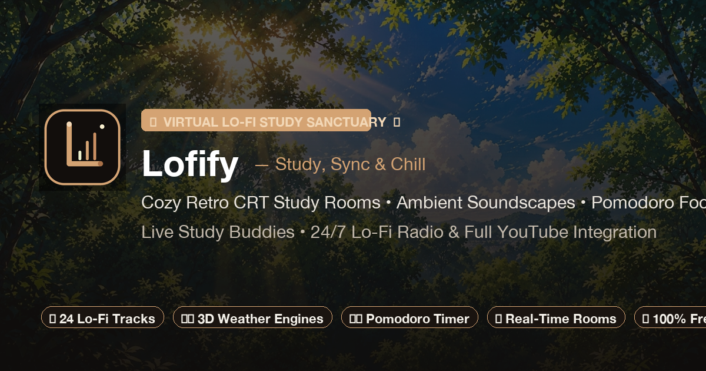
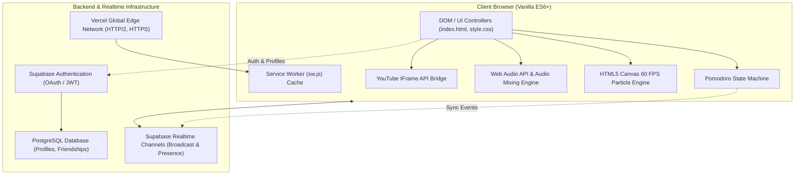

<div align="center">

  

  # Lofify
  ### Virtual Lo-Fi Study Room, Ambient Soundscapes & Focus Sanctuary

  [](https://lofify-chi.vercel.app/)
  [](LICENSE)
  [](https://developer.mozilla.org/en-US/docs/Web/JavaScript)
  [](https://supabase.com/)
  [](manifest.json)

  <p align="center">
    A lightweight, zero-framework, high-performance virtual study sanctuary designed for deep focus, Pomodoro session tracking, procedural ambient audio mixing, and real-time multiplayer study rooms.
  </p>

  <p align="center">
    <a href="#-features">Features</a> •
    <a href="#-architecture">Architecture</a> •
    <a href="#-tech-stack">Tech Stack</a> •
    <a href="#-directory-structure">Directory Structure</a> •
    <a href="#-database-schema">Database</a> •
    <a href="#-getting-started">Getting Started</a> •
    <a href="#-contributing">Contributing</a> •
    <a href="#-license">License</a>
  </p>

</div>

---

## 🌟 Overview

**Lofify** is an aesthetic, distraction-free digital workstation crafted for students, developers, and remote workers. Unlike resource-heavy electron wrappers or bloated single-page apps, Lofify is built purely on **native web standards**—delivering instantaneous load times (<150ms), sub-1% idle CPU consumption, and silky 60 FPS visual rendering.

Explore immersive scenes ranging from rain-drenched city lofts and Darjeeling tea estates to desert campfires and mountain cabins, all paired with synchronized lo-fi audio, custom weather physics, and shared study rooms.

---

## ✨ Features

### 👥 Real-Time Multiplayer Study Rooms
- **Synchronized Focus Clocks**: Hosts broadcast Pomodoro state transitions across connected participants using WebSocket pub/sub channels.
- **Room Knock Protocol**: Host-gated private room access with interactive knock approvals and real-time alerts.
- **Live Presence Roster**: Ephemeral participant avatars, active focus states, and study session counters powered by Supabase Presence.

### 🎧 Multi-Layer Web Audio Engine
- **Procedural Soundscape Mixer**: Independent `GainNode` audio routing for layered ambient tracks (thunderstorms, crackling fireplaces, blizzard gales, forest birds, wind chimes).
- **Curated 24/7 Lo-Fi Library**: Over 24 pre-buffered, high-fidelity lo-fi beats with seamless looped playback, randomized shuffle, and volume normalization.
- **YouTube Livestream Studio**: Native YouTube IFrame API integration with custom video/radio URL parsing and background streaming capability.

### ⏱️ Pomodoro Focus State Machine
- **Strict Interval Cycling**: Deterministic state machine supporting configurable Work (25m), Short Break (5m), and Long Break (15m) cycles.
- **Drift-Resistant Timing**: Delta-time compensated clock avoiding background tab throttling.
- **Persistent Analytics**: Tracks daily minutes studied, completed cycles, and focus streaks in `localStorage` and Supabase cloud profiles.

### 🎨 60 FPS HTML5 Canvas Visual Engines
- **Dynamic Weather Simulations**:
  - **Precipitation Engine**: Vectorized rain streaks with window-droplet splash physics.
  - **Winter Blizzard**: Randomized Perlin-like drifting snow particles.
  - **Desert Sandstorm**: Particle velocity fields simulating shifting dunes.
  - **Celebration Fireworks**: Multi-stage rocket trails and radial particle bursts with alpha decay.
- **Retro CRT Shader Post-Processing**: Canvas-based phosphor scanlines, subtle screen curvature, and chromatic aberration filters.

### 🔐 Authentication & Social Connections
- **Supabase Auth**: Secure passwordless and Google OAuth federated sign-in.
- **User Profiles**: Custom usernames, aesthetic avatars, status badges, and daily stats.
- **Friend System**: Search users by handle, send/accept study buddy requests, and see friend study activity in real time.
- **Account Data Control**: Transparent account data export and complete GDPR-compliant self-service profile deletion.

### 📱 Progressive Web App (PWA)
- **Installable**: Full PWA support with desktop/mobile install prompt (`manifest.json`).
- **Offline Resilient**: Service worker (`sw.js`) caching core app assets, UI components, and ambient soundscapes for offline study.

---

## 📐 Architecture



---

## 🛠️ Tech Stack

| Domain | Technology | Rationale |
| :--- | :--- | :--- |
| **Frontend Core** | Vanilla JavaScript (ES6+), HTML5, Modern CSS3 | Ultra-low memory footprint, zero compilation step, native performance. |
| **Audio Processing** | Web Audio API (`AudioContext`, `GainNode`) | Real-time multi-track audio layering, smooth volume curves, and non-blocking streaming. |
| **Graphics & FX** | HTML5 Canvas 2D Context | High-performance particle rendering with `requestAnimationFrame` lifecycle. |
| **Backend & Realtime**| [Supabase](https://supabase.com/) | Realtime WebSockets, Presence channels, Row Level Security (RLS), and PostgreSQL. |
| **Third-Party Media** | YouTube Player IFrame API | Embed live chillhop radio streams without server-side media re-streaming. |
| **Hosting & CI/CD** | [Vercel](https://vercel.com/) | Global Edge network, automated git-push continuous deployment, aggressive asset caching. |

---

## 📂 Directory Structure

```text
lofi-chill-room/
├── assets/
│   ├── audio/
│   │   ├── music/             # Curated lo-fi audio tracks (.mp3, .m4a)
│   │   └── soundscapes/       # Ambient procedural sounds (rain, fire, blizzard)
│   ├── images/
│   │   ├── avatars/           # Preset user avatar graphics
│   │   ├── scene_*/           # Aesthetic environmental backgrounds
│   │   ├── icon-*.png         # PWA app icons (192x192, 512x512 maskable)
│   │   └── og-banner.png      # 1200x630 High-res Open Graph banner
│   └── js/
│       └── fireworks.js       # Standalone canvas celebration particle engine
├── app.js                     # Core application controller & state orchestration
├── config.js                  # Supabase public credentials & backend flags
├── config.example.js          # Sanitized template for environment configuration
├── index.html                 # Semantic markup, SVG icons & structured metadata
├── style.css                  # Retro-modern design system, CRT filters & animations
├── manifest.json              # Web App Manifest for PWA installation
├── sw.js                      # Cache-first Service Worker for offline resilience
├── robots.txt                 # Search engine bot directives
├── sitemap.xml                # Canonical XML sitemap for SEO discovery
├── vercel.json                # Vercel edge deployment & cache headers
├── CONTRIBUTING.md            # Guidelines for community contributions
└── LICENSE                    # MIT open-source license
```

---

## 🗄️ Database Schema

If you are self-hosting your own Supabase instance, execute the following SQL in your Supabase SQL Editor:

```sql
-- 1. Profiles Table
CREATE TABLE IF NOT EXISTS public.profiles (
  id UUID REFERENCES auth.users(id) ON DELETE CASCADE PRIMARY KEY,
  username TEXT UNIQUE NOT NULL,
  display_name TEXT,
  avatar_url TEXT,
  bio TEXT DEFAULT '',
  study_minutes_today INT DEFAULT 0,
  study_minutes_total INT DEFAULT 0,
  current_status TEXT DEFAULT 'Studying',
  updated_at TIMESTAMP WITH TIME ZONE DEFAULT timezone('utc'::text, now()) NOT NULL
);

-- Enable RLS
ALTER TABLE public.profiles ENABLE ROW LEVEL SECURITY;

CREATE POLICY "Public profiles are viewable by everyone" 
  ON public.profiles FOR SELECT USING (true);

CREATE POLICY "Users can insert their own profile" 
  ON public.profiles FOR INSERT WITH CHECK (auth.uid() = id);

CREATE POLICY "Users can update their own profile" 
  ON public.profiles FOR UPDATE USING (auth.uid() = id);

-- 2. Friendships Table
CREATE TABLE IF NOT EXISTS public.friendships (
  id UUID DEFAULT gen_random_uuid() PRIMARY KEY,
  user_id UUID REFERENCES auth.users(id) ON DELETE CASCADE NOT NULL,
  friend_id UUID REFERENCES auth.users(id) ON DELETE CASCADE NOT NULL,
  status TEXT CHECK (status IN ('pending', 'accepted', 'blocked')) DEFAULT 'pending',
  created_at TIMESTAMP WITH TIME ZONE DEFAULT timezone('utc'::text, now()) NOT NULL,
  UNIQUE(user_id, friend_id)
);

ALTER TABLE public.friendships ENABLE ROW LEVEL SECURITY;

CREATE POLICY "Users can view their friendships" 
  ON public.friendships FOR SELECT 
  USING (auth.uid() = user_id OR auth.uid() = friend_id);

CREATE POLICY "Users can send friendship requests" 
  ON public.friendships FOR INSERT 
  WITH CHECK (auth.uid() = user_id);

CREATE POLICY "Users can update received friendship requests" 
  ON public.friendships FOR UPDATE 
  USING (auth.uid() = friend_id OR auth.uid() = user_id);

CREATE POLICY "Users can delete their friendships" 
  ON public.friendships FOR DELETE 
  USING (auth.uid() = user_id OR auth.uid() = friend_id);
```

---

## 🚀 Getting Started

### Prerequisites
All you need is a modern web browser (Chrome, Firefox, Safari, Edge, Brave) and a simple local HTTP server.

### Local Installation

1. **Clone the repository**:
   ```bash
   git clone https://github.com/Lostshayan/chill.git
   cd chill
   ```

2. **Configure Supabase Credentials**:
   - Inspect [`config.js`](config.js). By default, it connects to the production backend.
   - To connect to your own backend, copy [`config.example.js`](config.example.js) to `config.js` and input your project's URL and anonymous public key.

3. **Serve Locally**:
   Run with any static HTTP server:

   ```bash
   # Option A: Using Node.js
   npx serve .

   # Option B: Using Python 3
   python3 -m http.server 8080

   # Option C: Using PHP
   php -S localhost:8080
   ```

4. **Open in Browser**:
   Navigate to `http://localhost:8080` (or `http://localhost:3000`).

---

## 🌐 Deployment

The project is structured for zero-configuration deployment on **Vercel**, **Cloudflare Pages**, or **GitHub Pages**:

### Deploying to Vercel
1. Fork or push this repository to GitHub.
2. In the [Vercel Dashboard](https://vercel.com), click **Add New Project** and select your repository.
3. Leave build command and output directory empty (pure static site).
4. Click **Deploy**. Vercel will build and assign your production URL with instant HTTPS and global CDN caching.

---

## 🤝 Contributing

Contributions, feature suggestions, and bug reports are welcome! Please check the [Contributing Guide](CONTRIBUTING.md) for branch naming conventions, code standards, and PR workflows.

---

## 📄 License

This project is open-source and licensed under the [MIT License](LICENSE).

---

<div align="center">
  <sub>Built with ❤️ and coffee for focused minds worldwide.</sub>
</div>
